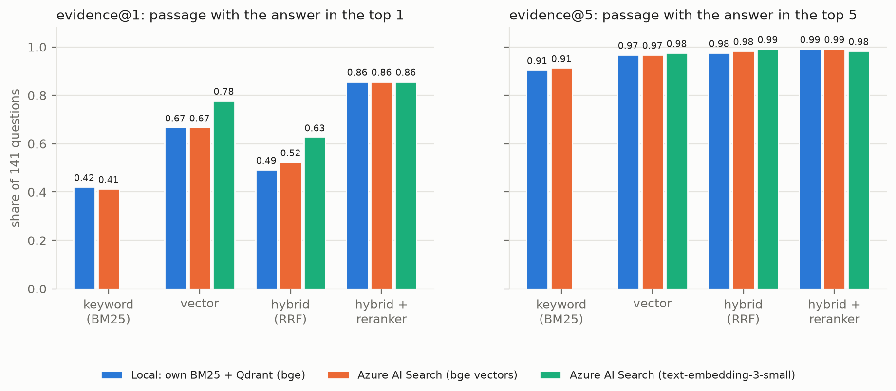
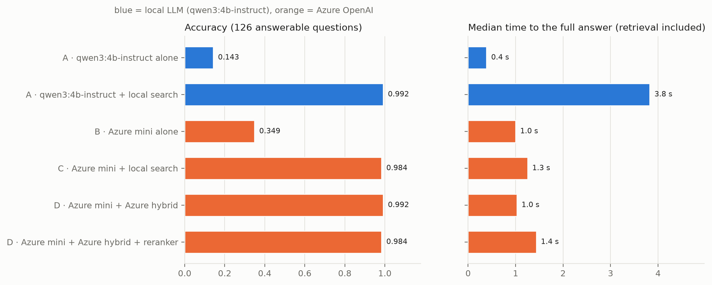
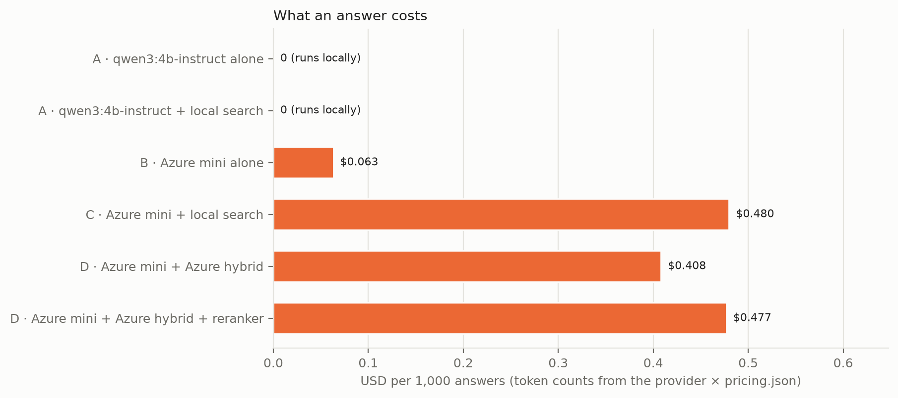

# 19 · Azure AI: the same RAG on Azure

🇸🇰 [Slovenská verzia](README.sk.md)

## TL;DR
- The clinical-trials RAG from [step 15](https://github.com/kavicka/15-rag-fullstack-clinical) runs on **two
  interchangeable stacks**, picked in `.env`, with no code change:
  - **local:** own BM25 + Qdrant, bge-small embeddings, `qwen3:4b-instruct` in Ollama;
  - **Azure:** Azure AI Search (Free tier), Azure OpenAI (`gpt-4.1-mini` + `text-embedding-3-small`).
- **Same quality, 3.7× faster, not free.** With retrieval, both stacks answer **99.2 %** of the 126 answerable
  questions correctly and refuse all 30 unanswerable ones. The full Azure stack answers in **1.0 s** (median)
  against **3.8 s** on the Mac, for **0.41 USD per 1,000 answers**. The local stack costs nothing.
- **Azure AI Search = own search engine.** With the same chunks and the same bge vectors it finds the evidence
  as often as own BM25 + Qdrant (evidence@5 0.91 / 0.97 / 0.98 / 0.99 for bm25 / dense / hybrid / rerank on both).
  `text-embedding-3-small` beats bge in the first stage (evidence@1 0.78 vs 0.67), but the reranker erases the
  gap (0.86 for all three).
- **Keyless:** Microsoft Entra ID (`az login`) + RBAC roles from Terraform. API keys are **disabled** on both Azure
  resources, so there is no secret in `.env`, in CI or in this repo.
- **Whole step cost about 0.47 USD** of Azure for Students credit (all runs, including two repeated after bugs,
  from the logged token counts), with a budget alert in Terraform and `make infra-destroy` afterwards.
- **Two measurement bugs found and fixed** before the final numbers: a 10 requests/minute limit that made
  Azure look 6× slower, and an Ollama tag that silently switched to a thinking model (see [Error analysis](#error-analysis)).

## Problem
Step 15 showed that retrieval turns a 1.7B model from 15.9 % to 96.8 % correct. The open question for a real team
is the platform: **is a managed cloud stack better, faster or cheaper than the one that runs on a laptop, and by
how much?** Three concrete questions:
1. **Search engine:** does Azure AI Search find the passage with the answer as well as own BM25 + Qdrant + RRF,
   when it gets exactly the same chunks and the same vectors?
2. **Embeddings:** is `text-embedding-3-small` better than the local `bge-small-en-v1.5` on these questions?
3. **LLM:** what does a cheap hosted "mini" model buy over a local 4B model in accuracy, latency and cost?

## Setup
- **Data:** the same 396 ClinicalTrials.gov trials as step 15 (`eval/study_ids.txt`), section-aware chunking,
  5,218 chunks. Questions: `eval/questions.jsonl` from step 15, unchanged (141 for retrieval, 156 for generation:
  126 answerable in 7 types + 30 unanswerable).
- **Local stack:** `BAAI/bge-small-en-v1.5` through onnxruntime (step 17), Qdrant in embedded mode, own BM25
  (k1 = 1.2, b = 0.75), RRF with k = 60, cross-encoder `ms-marco-MiniLM-L-6-v2`, `qwen3:4b-instruct` (Qwen3-4B
  Instruct 2507, Q4_K_M) in Ollama.
- **Azure stack:** Azure AI Search **Free** (BM25 with the same k1/b, `standard.lucene` analyzer, HNSW cosine) in
  `switzerlandnorth`; Azure OpenAI in `germanywestcentral`: `gpt-4.1-mini` (2025-04-14, pinned, 100k tokens/min)
  and `text-embedding-3-small` (shortened to 512 dimensions), GlobalStandard deployments, Entra ID only.
  - Why these and not `gpt-4o-mini` in `swedencentral` as planned: the Azure for Students subscription only
    allows five regions by policy, has **zero quota** for `gpt-4o-mini` in all of them, and the Search Free tier
    had no capacity in `germanywestcentral` that day (`InsufficientResourcesAvailable`). `make azure-preflight`
    found the first two before anything was created.
- **Generation:** temperature 0, at most 256 output tokens, top 5 chunks, the step 15 prompt.
- **Hardware:** Mac mini M4 Pro (Apple Silicon), local and Azure measured from the same machine and network on
  2026-11-05. Cross-encoder and bge on onnxruntime CPU, the LLM on the GPU through Ollama. Every run stores its
  date, machine, region and exact model versions in `meta` in `results.json`.

## How it works
```
                    ┌─ SEARCH_PROVIDER=local ──── own BM25 + Qdrant (bge) ─────────┐
question ─► get_retriever()                                                       ├─► Hits ─► prompt ─► get_llm() ─► answer
                    └─ SEARCH_PROVIDER=azure_search ─ Azure AI Search ─────────────┘          LLM_PROVIDER=ollama | azure_openai
                                                       EMBED_PROVIDER=local (vec_bge) | azure_openai (vec_te3)
```
- **One interface, two stacks** (`rag/retrieve.py`, `rag/azure_search.py`). Both retrievers return the same `Hit`
  objects for the same four modes, so the API, the React UI and the eval never know which stack runs:

  | mode | local | Azure AI Search |
  |---|---|---|
  | `bm25` | own BM25 | full-text search, BM25 with the same k1/b |
  | `dense` | bge vectors in Qdrant | the same bge vectors, or text-embedding-3-small, in HNSW |
  | `hybrid` | own RRF over both lists | Azure's built-in RRF over the text + vector query |
  | `rerank` | hybrid top 20 → cross-encoder | Azure hybrid top 20 → **the same local cross-encoder** |

  Azure's own reranker (semantic ranker) is not available on the Free tier. Using the same cross-encoder on both
  stacks also isolates what Azure's first stage finds.
- **A fair engine comparison needs care** (`rag/azure_search.py`):
  - Azure gets **the very same bge vectors** as Qdrant: `rag/index.py` saves them, `rag/azure_index.py` uploads them.
  - Only the chunk `text` is searchable. In the REST API string fields are searchable **by default**, so `title`,
    `nct_id` and `section` are set to `searchable=False` explicitly; otherwise BM25 would score other text.
  - Questions are reduced to plain words before the keyword query. Azure's simple syntax reads `"…"` as a phrase,
    `-x` as NOT and `*` as a prefix, and the questions quote trial titles and contain hyphens.
- **Keyless access** (`rag/azure_auth.py`, `infra/main.tf`):
  - Terraform sets `local_auth_enabled = false` (OpenAI) and `local_authentication_enabled = false` (Search).
  - It gives the logged-in user three roles and nothing more: *Cognitive Services OpenAI User*, *Search Service
    Contributor* (the index schema) and *Search Index Data Contributor* (documents and queries).
  - The code uses `DefaultAzureCredential`. The openai SDK gets a token provider instead of a key and talks to the
    **v1 API** (`…/openai/v1/`, no `api-version`). The first token takes about 1.5 s (`az` CLI), later ones come
    from the cache.
- **Real cost per answer** (`rag/llm.py`, `rag/pricing.py`):
  - Azure streams with `stream_options={"include_usage": true}`; the last chunk carries the token counts and the
    exact model version.
  - `pricing.json` turns them into USD. The prices come from Azure's official
    [Retail Prices API](https://prices.azure.com/api/retail/prices) (Global Standard meters, checked 2026-11-05):
    `gpt-4.1-mini` 0.40 / 1.60 USD per 1M input / output tokens, `text-embedding-3-small` 0.02 USD. A model that
    is not in the file gets no price, never a guess.
  - Local models count as 0 USD; electricity is not included.
- **Terraform** (`infra/`): azurerm 5.x, one resource group, Azure OpenAI with two pinned deployments
  (`NoAutoUpgrade`, so the model cannot change between runs), Search Free, three role assignments and a budget
  alert. `openai_location` and `search_location` can put a service in another allowed region when one is out of
  quota or capacity. Resource names get a hash of the subscription, so they are globally unique and stable
  without a random provider.

## Results
All numbers are from `results.json` (runs on 2026-11-05, Mac mini M4 Pro, Azure in `switzerlandnorth` /
`germanywestcentral`).



| Retrieval (141 questions) | evidence@1 | evidence@5 | MRR@10 | p50 latency |
|---|---|---|---|---|
| local · bm25 | 0.421 | 0.905 | 0.613 | 0.2 ms |
| local · dense (bge) | 0.667 | 0.968 | 0.788 | 6.6 ms |
| local · hybrid | 0.492 | 0.976 | 0.705 | 7.2 ms |
| local · rerank | **0.857** | 0.992 | **0.917** | 287 ms |
| Azure AI Search · bm25 | 0.413 | 0.913 | 0.610 | 49 ms |
| Azure AI Search + bge · dense | 0.667 | 0.968 | 0.788 | 58 ms |
| Azure AI Search + bge · hybrid | 0.524 | 0.984 | 0.725 | 92 ms |
| Azure AI Search + bge · rerank | **0.857** | 0.992 | **0.917** | 463 ms |
| Azure AI Search + text-embedding-3-small · dense | 0.778 | 0.976 | 0.859 | 252 ms |
| Azure AI Search + text-embedding-3-small · hybrid | 0.627 | 0.992 | 0.779 | 287 ms |
| Azure AI Search + text-embedding-3-small · rerank | **0.857** | 0.984 | **0.917** | 646 ms |

Azure latencies include the network round trip from the Mac; with text-embedding-3-small they also include one
embedding call per question.



| Generation (156 questions) | accuracy | grounded | abstain (unanswerable) | TTFT p50 | latency p50 | USD / 1,000 answers |
|---|---|---|---|---|---|---|
| A · qwen3:4b-instruct alone | 0.143 | 0.0 | 1.0 | 0.15 s | 0.4 s | 0 |
| A · qwen3:4b-instruct + local rerank | **0.992** | **0.992** | 1.0 | 2.79 s | 3.8 s | 0 |
| B · gpt-4.1-mini alone | 0.349 | 0.0 | 0.733 | 0.94 s | 1.0 s | 0.063 |
| C · gpt-4.1-mini + local rerank | 0.984 | 0.984 | 1.0 | 1.15 s | 1.3 s | 0.480 |
| D · gpt-4.1-mini + Azure hybrid | **0.992** | **0.992** | 1.0 | 0.93 s | **1.0 s** | 0.408 |
| D · gpt-4.1-mini + Azure hybrid + rerank | 0.984 | 0.984 | 1.0 | 1.35 s | 1.4 s | 0.477 |

*accuracy* is over the 126 answerable questions, *grounded* = correct and citing a retrieved trial, *abstain* =
share of the 30 unanswerable questions answered with "I don't know". TTFT and latency are measured from the
question, so they include retrieval.



What the numbers say:
- **The search engine does not matter here.** Azure AI Search with the same bge vectors gives the same dense
  results to three decimals and BM25 within one question. Its hybrid is slightly better at the top (evidence@1
  0.524 vs 0.492). Its latency is tens of milliseconds instead of single ones, mostly the network.
- **Better embeddings help only without a reranker.** text-embedding-3-small puts the evidence first 11 points
  more often than bge, but after the cross-encoder all three first stages end at 0.857 / 0.917.
- **The model matters only without retrieval.** Alone, gpt-4.1-mini knows more than the 4B model (0.349 vs
  0.143). The difference is honesty as much as knowledge: without sources the 4B model says "I don't know" to 77 %
  of the answerable questions and to all unanswerable ones, while gpt-4.1-mini guesses and answers 27 % of the
  unanswerable questions anyway. With retrieval both are at 98–99 %.
- **Azure's advantage is time, not quality.** On the Mac the 4B model needs 2.8 s before the first token with
  ~1,200 tokens of context; Azure needs 0.9 s. The price for that is about 0.4 USD per 1,000 answers.

## Error analysis
Two problems made the first results wrong. Both were found by reading the per-question runs
(`eval/runs/*.jsonl`), not the averages, and both runs were repeated:

1. **Azure looked 6× slower than it is.** The first Azure run had a median latency of **6.0 s** for every
   variant, even for 21-token answers. A direct call took 0.6 s. The response headers showed why:
   `x-ratelimit-limit-requests: 10`. A deployment with 10k tokens/minute gets **10 requests per minute**, the SDK
   waited for each 429 to clear (`max_retries=8`), and the eval measured the waiting. With 100k tokens/minute
   (free to set: the price is per token, not per capacity) the median fell to 1.0 s and accuracy stayed
   identical. The embedding upload hit the same kind of limit: 1.38M tokens at 50k tokens/minute cannot take less than
   28 minutes, and it took 31.
2. **The local model was secretly a thinking model.** With the Ollama tag `qwen3:4b`, accuracy with retrieval was
   0.881 and only half of the correct answers cited a source. The answers began with *"Okay, let me tackle this
   question step by step…"*, a few even reasoned about a different question, and the 256-token limit cut them off
   before the answer and the citation. `qwen3:4b` now points to the 2507 **thinking** model, which ignores
   `"think": false` and writes its reasoning into the answer. `qwen3:4b-instruct` answers directly: 0.992
   accuracy, 0.992 grounded, 3.8 s instead of 6.9 s.

The remaining wrong answers after the fixes (out of 126 answerable questions per run):

| question | gold | answer | runs | cause |
|---|---|---|---|---|
| q119 min age, "Aging Brain Care Virtual Program" | 18 | 65 years | A, C, D-rerank | **label problem:** patients must be 65+, care partners 18+; the structured field says 18. The answer is defensible. |
| q035 enrollment | 24 | "Twenty-four participants…" | C, D-rerank | **grader false negative:** correct, but written in words and the grader looks for digits |
| q123 min age | 60 | "I don't know." | D-hybrid | **false refusal:** the evidence was retrieved, the model refused anyway |

So of the 2 errors per run, one is a label problem and one a grader problem; the real error rate of the final
stacks is about one question in 126.

Also found on the way:
- **Azure AI Search Free does not enforce its 50 MB limit at upload.** After indexing, the service reported
  **83.2 MB** of storage (55.2 MB of it vectors: two vector fields, 384 + 512 dimensions) against a 50 MB quota,
  and accepted every document.
- **BM25 local vs Azure:** the same formula, different tokenization (Lucene standard tokenizer vs own regex).
  Aggregate results differ by one question at @1 and @5 (0.421 vs 0.413, 0.905 vs 0.913).
- **HNSW settings** (Qdrant m = 16, Azure m = 4, efSearch = 500) make no difference at 5,218 chunks: dense results
  are identical.

## What I learned
- **A plausible number can be a measurement of the wrong thing.** Both bugs produced believable results (6 s for
  a cloud LLM, 88 % for a 4B model). They only showed up in per-question records: identical latencies across
  very different prompts, and answers that started with a monologue. Reading raw outputs before writing the README
  is part of the measurement.
- **Rate limits are part of the deployment, not of the model.** On Azure, tokens-per-minute capacity also sets
  requests per minute. A sequential eval against a small deployment measures the throttle.
- **Keyless is not harder than keys**, it only moves the work into Terraform: three role assignments instead of
  copying a key into `.env`. A leaked `.env` now contains nothing that grants access.
- **"Same search, different engine" is full of hidden defaults.** String fields searchable by default, query
  operators inside natural-language questions, a different analyzer and different HNSW parameters would each have
  skewed the comparison without an error message. With those pinned down, the two engines are equal.
- **The cloud SDKs can be tested without the cloud.** A fake HTTP transport under the real SDK checks the URL, the
  auth header and the exact JSON body. That caught a real bug before any Azure call: model-name matching would
  have priced `gpt-4o-mini-tts` as `gpt-4o-mini`.
- **Azure for Students is not "free Azure OpenAI".** Model quota can be zero, regions are locked by policy, and a
  Free service can be out of capacity in a region. The plan changed three times before the first resource existed.

## Run it
```bash
make sync                      # Python (onnx + azure extras) + frontend
cp .env.example .env
make data index-local          # 396 trials, local index (bge embeddings: 195 s on the Mac)
make test                      # 48 Python tests + terraform test, no Azure needed
```
Azure, in order (on the Mac, logged in with `az login`):
```bash
make azure-preflight LOCATION=germanywestcentral   # account, region policy, models, quota
cp infra/terraform.tfvars.example infra/terraform.tfvars   # region, model, capacity, budget e-mail
make infra-apply               # resource group, Azure OpenAI + 2 deployments, Search Free, roles, budget
make env-from-tf               # endpoints → .env.azure (nothing secret)
make azure-check               # token, one tiny call per deployment, real Free-tier quota → results.json
make index-azure               # upload chunks + bge + text-embedding-3-small vectors
make eval-local                # retrieval + run A (needs `ollama serve`, `ollama pull qwen3:4b-instruct`)
make eval-azure-retrieval      # Azure + bge, Azure + text-embedding-3-small
make eval-azure-generation     # runs B, C, D  (D_EMBED=azure_openai to use text-embedding-3-small in D)
make plot
make infra-destroy             # nothing keeps running or billing
```
Run the app on either stack: set `SEARCH_PROVIDER` / `LLM_PROVIDER` in `.env`, then `make api` and `make web`.

## Limitations
- **One run, one day.** Azure AI Search Free runs on shared infrastructure without an SLA, so its latency can
  vary from day to day. Latency also includes the network round trip from the Mac to the regions.
- **The questions are easy for a good retriever.** All 7 question types ask for one field of one named trial.
  Both stacks are at 98–99 %, so these questions cannot separate the two LLMs once retrieval works; harder,
  multi-trial questions would be needed for that.
- **Run D used bge vectors** in Azure AI Search (the default). text-embedding-3-small would change only the
  hybrid variant, where its first stage is better; it was not measured end to end.
- **No semantic ranker:** not available on the Free tier, so Azure's own reranker is not measured.
- **GlobalStandard** deployments may process prompts in any Azure region. That is acceptable for public trial
  records, not for patient data (use DataZoneStandard: `deployment_sku` in `infra/terraform.tfvars`).
- The app itself is not hosted on Azure. That would be Container Apps with the images from step 17, out of scope
  here.
- **Why no Racing Lab chapter:** swapping a cloud provider behind an interface is not a concept that maps to cars.
  The visual example is the React UI, which shows which stack answered, plus the plots above.
