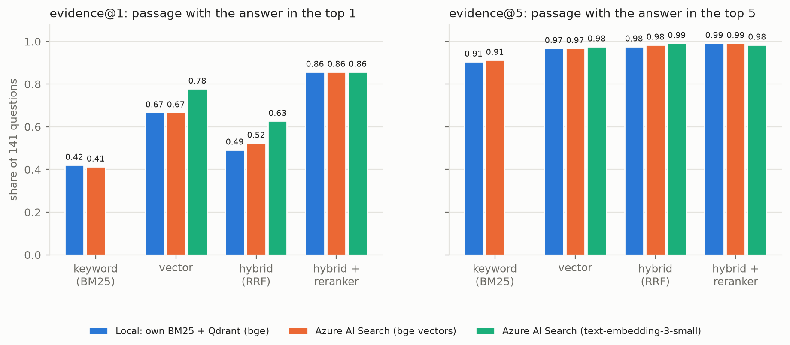
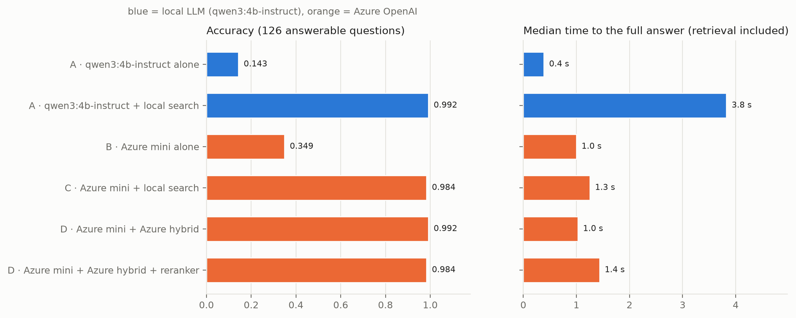
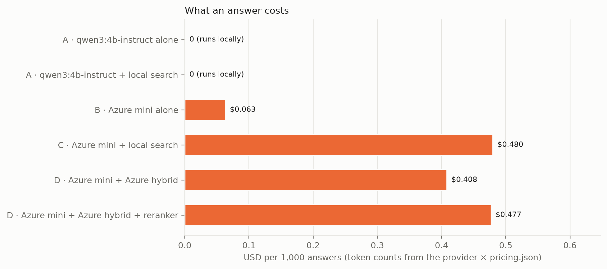

# 19 · Azure AI: ten istý RAG na Azure

🇬🇧 [English version](README.md)

## TL;DR
- RAG nad klinickými štúdiami z [kroku 15](https://github.com/kavicka/15-rag-fullstack-clinical) beží na **dvoch
  zameniteľných stackoch**, ktoré sa volia v `.env`, bez zmeny kódu:
  - **lokálne:** vlastný BM25 + Qdrant, embeddingy bge-small, `qwen3:4b-instruct` v Ollame;
  - **Azure:** Azure AI Search (Free tier), Azure OpenAI (`gpt-4.1-mini` + `text-embedding-3-small`).
- **Rovnaká kvalita, 3,7× rýchlejšie, nie zadarmo.** S vyhľadávaním oba stacky správne zodpovedia **99,2 %**
  zo 126 zodpovedateľných otázok a odmietnu všetkých 30 nezodpovedateľných. Celý Azure stack odpovie za **1,0 s**
  (medián) oproti **3,8 s** na Macu, za **0,41 USD na 1 000 odpovedí**. Lokálny stack nestojí nič.
- **Azure AI Search = vlastný vyhľadávač.** S rovnakými chunkami a rovnakými bge vektormi nájde dôkaz rovnako
  často ako vlastný BM25 + Qdrant (evidence@5 0,91 / 0,97 / 0,98 / 0,99 pre bm25 / dense / hybrid / rerank na
  oboch). `text-embedding-3-small` je v prvom stupni lepší ako bge (evidence@1 0,78 vs 0,67), reranker však
  rozdiel zmaže (0,86 pre všetky tri).
- **Bez kľúčov:** Microsoft Entra ID (`az login`) + RBAC roly z Terraformu. API kľúče sú na oboch Azure zdrojoch
  **vypnuté**, takže v `.env`, v CI ani v tomto repe nie je žiadne tajomstvo.
- **Celý krok stál asi 0,47 USD** z kreditu Azure for Students (všetky behy vrátane dvoch zopakovaných po
  chybách, podľa zalogovaných počtov tokenov), s budget alertom v Terraforme a `make infra-destroy` na konci.
- **Dve chyby merania nájdené a opravené** pred finálnymi číslami: limit 10 požiadaviek za minútu, kvôli ktorému
  Azure vyzeral 6× pomalší, a tag v Ollame, ktorý potichu prešiel na thinking model (pozri
  [Analýza chýb](#analýza-chýb)).

## Problém
Krok 15 ukázal, že vyhľadávanie zvýši úspešnosť 1,7B modelu z 15,9 % na 96,8 %. Pre skutočný tím ostáva otvorená
otázka platformy: **je spravovaný cloudový stack lepší, rýchlejší alebo lacnejší ako ten, ktorý beží na
notebooku, a o koľko?** Tri konkrétne otázky:
1. **Vyhľadávač:** nájde Azure AI Search pasáž s odpoveďou rovnako dobre ako vlastný BM25 + Qdrant + RRF, keď
   dostane presne tie isté chunky a tie isté vektory?
2. **Embeddingy:** je `text-embedding-3-small` na týchto otázkach lepší ako lokálny `bge-small-en-v1.5`?
3. **LLM:** čo prinesie lacný hosťovaný „mini“ model oproti lokálnemu 4B modelu v presnosti, latencii a cene?

## Setup
- **Dáta:** tých istých 396 štúdií z ClinicalTrials.gov ako v kroku 15 (`eval/study_ids.txt`), chunking podľa
  sekcií, 5 218 chunkov. Otázky: `eval/questions.jsonl` z kroku 15, bez zmeny (141 na vyhľadávanie, 156 na
  generovanie: 126 zodpovedateľných v 7 typoch + 30 nezodpovedateľných).
- **Lokálny stack:** `BAAI/bge-small-en-v1.5` cez onnxruntime (krok 17), Qdrant v embedded režime, vlastný BM25
  (k1 = 1,2, b = 0,75), RRF s k = 60, cross-encoder `ms-marco-MiniLM-L-6-v2`, `qwen3:4b-instruct` (Qwen3-4B
  Instruct 2507, Q4_K_M) v Ollame.
- **Azure stack:** Azure AI Search **Free** (BM25 s rovnakými k1/b, analyzátor `standard.lucene`, HNSW cosine)
  v `switzerlandnorth`; Azure OpenAI v `germanywestcentral`: `gpt-4.1-mini` (2025-04-14, pripnutá verzia,
  100k tokenov/min) a `text-embedding-3-small` (skrátený na 512 dimenzií), GlobalStandard deploymenty, len Entra ID.
  - Prečo tieto a nie `gpt-4o-mini` v `swedencentral`, ako bolo v pláne: subscription Azure for Students povoľuje
    politikou len päť regiónov, má **nulovú kvótu** na `gpt-4o-mini` vo všetkých z nich a Search Free tier v ten
    deň nemal kapacitu v `germanywestcentral` (`InsufficientResourcesAvailable`). Prvé dve veci našiel
    `make azure-preflight` ešte predtým, ako sa čokoľvek vytvorilo.
- **Generovanie:** teplota 0, najviac 256 výstupných tokenov, top 5 chunkov, prompt z kroku 15.
- **Hardvér:** Mac mini M4 Pro (Apple Silicon), lokálny aj Azure stack merané z toho istého stroja a siete
  5. 11. 2026. Cross-encoder a bge na onnxruntime CPU, LLM na GPU cez Ollamu. Každý beh si ukladá dátum, stroj,
  región a presné verzie modelov do `meta` v `results.json`.

## Ako to funguje
```
                    ┌─ SEARCH_PROVIDER=local ──── vlastný BM25 + Qdrant (bge) ─────┐
otázka ─► get_retriever()                                                         ├─► Hits ─► prompt ─► get_llm() ─► odpoveď
                    └─ SEARCH_PROVIDER=azure_search ─ Azure AI Search ─────────────┘          LLM_PROVIDER=ollama | azure_openai
                                                       EMBED_PROVIDER=local (vec_bge) | azure_openai (vec_te3)
```
- **Jedno rozhranie, dva stacky** (`rag/retrieve.py`, `rag/azure_search.py`). Oba retrievery vracajú tie isté
  objekty `Hit` pre tie isté štyri režimy, takže API, React UI ani eval nevedia, ktorý stack beží:

  | režim | lokálne | Azure AI Search |
  |---|---|---|
  | `bm25` | vlastný BM25 | full-text vyhľadávanie, BM25 s rovnakými k1/b |
  | `dense` | bge vektory v Qdrante | tie isté bge vektory alebo text-embedding-3-small v HNSW |
  | `hybrid` | vlastné RRF nad oboma zoznamami | vstavané RRF Azure nad textovým + vektorovým dotazom |
  | `rerank` | hybrid top 20 → cross-encoder | Azure hybrid top 20 → **ten istý lokálny cross-encoder** |

  Vlastný reranker Azure (semantic ranker) na Free tieri nie je. Rovnaký cross-encoder na oboch stackoch zároveň
  izoluje, čo nájde prvý stupeň Azure.
- **Férové porovnanie vyhľadávačov chce pozornosť** (`rag/azure_search.py`):
  - Azure dostane **presne tie isté bge vektory** ako Qdrant: `rag/index.py` ich uloží, `rag/azure_index.py` ich
    nahrá.
  - Prehľadávateľný je len `text` chunku. V REST API sú textové polia prehľadávateľné **predvolene**, preto majú
    `title`, `nct_id` a `section` explicitne `searchable=False`; inak by BM25 skóroval aj iný text.
  - Otázky sa pred kľúčovým dotazom zredukujú na obyčajné slová. Jednoduchá syntax Azure číta `"…"` ako frázu,
    `-x` ako NOT a `*` ako prefix, a otázky citujú názvy štúdií a obsahujú pomlčky.
- **Prístup bez kľúčov** (`rag/azure_auth.py`, `infra/main.tf`):
  - Terraform nastaví `local_auth_enabled = false` (OpenAI) a `local_authentication_enabled = false` (Search).
  - Prihlásenému používateľovi dá tri roly a nič viac: *Cognitive Services OpenAI User*, *Search Service
    Contributor* (schéma indexu) a *Search Index Data Contributor* (dokumenty a dotazy).
  - Kód používa `DefaultAzureCredential`. SDK openai dostane namiesto kľúča poskytovateľa tokenov a komunikuje cez
    **v1 API** (`…/openai/v1/`, bez `api-version`). Prvý token trvá asi 1,5 s (`az` CLI), ďalšie idú z cache.
- **Skutočná cena za odpoveď** (`rag/llm.py`, `rag/pricing.py`):
  - Azure streamuje so `stream_options={"include_usage": true}`; posledný chunk nesie počty tokenov a presnú
    verziu modelu.
  - `pricing.json` ich prevedie na USD. Ceny sú z oficiálneho
    [Retail Prices API](https://prices.azure.com/api/retail/prices) Azure (Global Standard metre, overené
    5. 11. 2026): `gpt-4.1-mini` 0,40 / 1,60 USD za 1M vstupných / výstupných tokenov, `text-embedding-3-small`
    0,02 USD. Model, ktorý v súbore nie je, nedostane žiadnu cenu, nikdy nie odhad.
  - Lokálne modely sa rátajú ako 0 USD; elektrina nie je zahrnutá.
- **Terraform** (`infra/`): azurerm 5.x, jedna resource group, Azure OpenAI s dvoma pripnutými deploymentmi
  (`NoAutoUpgrade`, aby sa model medzi behmi nemohol zmeniť), Search Free, tri priradenia rolí a budget alert.
  `openai_location` a `search_location` vedia dať službu do iného povoleného regiónu, keď v jednom chýba kvóta
  alebo kapacita. Názvy zdrojov dostanú hash subscription, takže sú globálne unikátne a stabilné bez random
  providera.

## Výsledky
Všetky čísla sú z `results.json` (behy 5. 11. 2026, Mac mini M4 Pro, Azure v `switzerlandnorth` /
`germanywestcentral`).



| Vyhľadávanie (141 otázok) | evidence@1 | evidence@5 | MRR@10 | latencia p50 |
|---|---|---|---|---|
| lokálne · bm25 | 0,421 | 0,905 | 0,613 | 0,2 ms |
| lokálne · dense (bge) | 0,667 | 0,968 | 0,788 | 6,6 ms |
| lokálne · hybrid | 0,492 | 0,976 | 0,705 | 7,2 ms |
| lokálne · rerank | **0,857** | 0,992 | **0,917** | 287 ms |
| Azure AI Search · bm25 | 0,413 | 0,913 | 0,610 | 49 ms |
| Azure AI Search + bge · dense | 0,667 | 0,968 | 0,788 | 58 ms |
| Azure AI Search + bge · hybrid | 0,524 | 0,984 | 0,725 | 92 ms |
| Azure AI Search + bge · rerank | **0,857** | 0,992 | **0,917** | 463 ms |
| Azure AI Search + text-embedding-3-small · dense | 0,778 | 0,976 | 0,859 | 252 ms |
| Azure AI Search + text-embedding-3-small · hybrid | 0,627 | 0,992 | 0,779 | 287 ms |
| Azure AI Search + text-embedding-3-small · rerank | **0,857** | 0,984 | **0,917** | 646 ms |

Latencie Azure zahŕňajú sieťovú cestu z Macu a späť; s text-embedding-3-small aj jedno volanie embeddingu na
otázku.



| Generovanie (156 otázok) | presnosť | podložené | odmietnutie (nezodpov.) | TTFT p50 | latencia p50 | USD / 1 000 odpovedí |
|---|---|---|---|---|---|---|
| A · qwen3:4b-instruct sám | 0,143 | 0,0 | 1,0 | 0,15 s | 0,4 s | 0 |
| A · qwen3:4b-instruct + lokálny rerank | **0,992** | **0,992** | 1,0 | 2,79 s | 3,8 s | 0 |
| B · gpt-4.1-mini sám | 0,349 | 0,0 | 0,733 | 0,94 s | 1,0 s | 0,063 |
| C · gpt-4.1-mini + lokálny rerank | 0,984 | 0,984 | 1,0 | 1,15 s | 1,3 s | 0,480 |
| D · gpt-4.1-mini + Azure hybrid | **0,992** | **0,992** | 1,0 | 0,93 s | **1,0 s** | 0,408 |
| D · gpt-4.1-mini + Azure hybrid + rerank | 0,984 | 0,984 | 1,0 | 1,35 s | 1,4 s | 0,477 |

*Presnosť* je zo 126 zodpovedateľných otázok, *podložené* = správne a s citáciou vyhľadanej štúdie,
*odmietnutie* = podiel z 30 nezodpovedateľných otázok, na ktoré prišlo „I don't know“. TTFT aj latencia sa merajú
od otázky, takže zahŕňajú vyhľadávanie.



Čo z čísel vyplýva:
- **Na vyhľadávači tu nezáleží.** Azure AI Search s rovnakými bge vektormi dá rovnaké dense výsledky na tri
  desatinné miesta a BM25 sa líši najviac o jednu otázku. Jeho hybrid je navrchu o niečo lepší (evidence@1 0,524
  vs 0,492). Latencia je v desiatkach milisekúnd namiesto jednotiek, hlavne kvôli sieti.
- **Lepšie embeddingy pomôžu len bez rerankera.** text-embedding-3-small dá dôkaz na prvé miesto o 11 bodov
  častejšie ako bge, ale po cross-encoderi skončia všetky tri prvé stupne na 0,857 / 0,917.
- **Na modeli záleží len bez vyhľadávania.** Sám vie gpt-4.1-mini viac ako 4B model (0,349 vs 0,143). Rozdiel je
  však rovnako v poctivosti ako vo vedomostiach: bez zdrojov povie 4B model „I don't know“ na 77 %
  zodpovedateľných otázok a na všetky nezodpovedateľné, kým gpt-4.1-mini háda a 27 % nezodpovedateľných otázok
  aj tak zodpovie. S vyhľadávaním sú oba na 98–99 %.
- **Výhodou Azure je čas, nie kvalita.** Na Macu potrebuje 4B model 2,8 s do prvého tokenu s ~1 200 tokenmi
  kontextu; Azure 0,9 s. Cena za to je asi 0,4 USD na 1 000 odpovedí.

## Analýza chýb
Dva problémy spravili prvé výsledky nesprávnymi. Oba sa našli čítaním behov po otázkach (`eval/runs/*.jsonl`),
nie priemerov, a oba behy sa zopakovali:

1. **Azure vyzeral 6× pomalší, ako je.** Prvý beh na Azure mal medián latencie **6,0 s** pri každej variante, aj
   pri odpovediach s 21 tokenmi. Priame volanie trvalo 0,6 s. Dôvod ukázali hlavičky odpovede:
   `x-ratelimit-limit-requests: 10`. Deployment s 10k tokenmi za minútu dostane **10 požiadaviek za minútu**, SDK
   čakalo, kým každá 429 pominie (`max_retries=8`), a eval meral čakanie. So 100k tokenmi za minútu (nastaviť to
   nič nestojí: platí sa za tokeny, nie za kapacitu) klesol medián na 1,0 s a presnosť ostala rovnaká. Nahrávanie
   embeddingov narazilo na ten istý druh limitu: 1,38M tokenov pri 50k tokenoch za minútu nemôže trvať menej ako
   28 minút, trvalo 31.
2. **Lokálny model bol potajomky thinking model.** S tagom `qwen3:4b` v Ollame bola presnosť s vyhľadávaním 0,881
   a len polovica správnych odpovedí citovala zdroj. Odpovede začínali *„Okay, let me tackle this question step by
   step…“*, niektoré dokonca uvažovali o inej otázke a limit 256 tokenov ich odrezal ešte pred odpoveďou
   a citáciou. `qwen3:4b` dnes ukazuje na **thinking** model 2507, ktorý ignoruje `"think": false` a svoje úvahy
   píše do odpovede. `qwen3:4b-instruct` odpovedá priamo: presnosť 0,992, podložených 0,992, 3,8 s namiesto 6,9 s.

Zvyšné chybné odpovede po opravách (zo 126 zodpovedateľných otázok na beh):

| otázka | správne | odpoveď | behy | príčina |
|---|---|---|---|---|
| q119 min. vek, „Aging Brain Care Virtual Program“ | 18 | 65 rokov | A, C, D-rerank | **problém s labelom:** pacienti musia mať 65+, opatrovatelia 18+; štruktúrované pole hovorí 18. Odpoveď je obhájiteľná. |
| q035 počet účastníkov | 24 | „Twenty-four participants…“ | C, D-rerank | **falošne negatívny grader:** správne, ale slovom a grader hľadá číslice |
| q123 min. vek | 60 | „I don't know.“ | D-hybrid | **nesprávne odmietnutie:** dôkaz bol vyhľadaný, model aj tak odmietol |

Z 2 chýb na beh je teda jedna problém labelu a jedna problém gradera; skutočná chybovosť finálnych stackov je
asi jedna otázka zo 126.

Ďalšie zistenia popri tom:
- **Azure AI Search Free pri nahrávaní nevynucuje svoj 50 MB limit.** Po indexovaní služba hlásila **83,2 MB**
  úložiska (z toho 55,2 MB vektory: dve vektorové polia, 384 + 512 dimenzií) oproti kvóte 50 MB a prijala každý
  dokument.
- **BM25 lokálne vs Azure:** rovnaký vzorec, iná tokenizácia (Lucene standard tokenizer vs vlastný regex).
  Súhrnné výsledky sa líšia o jednu otázku pri @1 aj @5 (0,421 vs 0,413, 0,905 vs 0,913).
- **Nastavenia HNSW** (Qdrant m = 16, Azure m = 4, efSearch = 500) pri 5 218 chunkoch nič nemenia: dense výsledky
  sú identické.

## Čo som sa naučil
- **Uveriteľné číslo môže byť meraním nesprávnej veci.** Obe chyby dali uveriteľné výsledky (6 s pre cloudový LLM,
  88 % pre 4B model). Ukázali sa len v záznamoch po otázkach: rovnaké latencie pri veľmi rôznych promptoch
  a odpovede, ktoré začínali monológom. Čítanie surových výstupov pred písaním README je súčasťou merania.
- **Rate limity patria k deploymentu, nie k modelu.** Na Azure kapacita v tokenoch za minútu určuje aj počet
  požiadaviek za minútu. Sekvenčný eval proti malému deploymentu meria škrtenie.
- **Bez kľúčov to nie je ťažšie ako s kľúčmi**, len sa práca presunie do Terraformu: tri priradenia rolí namiesto
  kopírovania kľúča do `.env`. Uniknutý `.env` teraz neobsahuje nič, čo dáva prístup.
- **„Rovnaké vyhľadávanie, iný engine“ je plné skrytých predvolieb.** Textové polia prehľadávateľné predvolene,
  operátory dotazu v otázkach v prirodzenom jazyku, iný analyzátor a iné parametre HNSW by každé skreslilo
  porovnanie bez chybovej hlášky. Keď sú pripnuté, oba vyhľadávače sú rovnaké.
- **Cloudové SDK sa dajú testovať bez cloudu.** Falošný HTTP transport pod skutočným SDK kontroluje URL,
  autorizačnú hlavičku aj presné JSON telo. Tak sa ešte pred prvým volaním Azure našla skutočná chyba: porovnávanie
  názvov modelov by ocenilo `gpt-4o-mini-tts` ako `gpt-4o-mini`.
- **Azure for Students nie je „Azure OpenAI zadarmo“.** Kvóta modelu môže byť nulová, regióny sú zamknuté
  politikou a Free služba môže v regióne nemať kapacitu. Plán sa zmenil trikrát, kým vznikol prvý zdroj.

## Spustenie
```bash
make sync                      # Python (onnx + azure extras) + frontend
cp .env.example .env
make data index-local          # 396 štúdií, lokálny index (bge embeddingy: 195 s na Macu)
make test                      # 48 Python testov + terraform test, Azure netreba
```
Azure, v tomto poradí (na Macu, prihlásený cez `az login`):
```bash
make azure-preflight LOCATION=germanywestcentral   # účet, politika regiónov, modely, kvóta
cp infra/terraform.tfvars.example infra/terraform.tfvars   # región, model, kapacita, e-mail pre budget
make infra-apply               # resource group, Azure OpenAI + 2 deploymenty, Search Free, roly, budget
make env-from-tf               # endpointy → .env.azure (nič tajné)
make azure-check               # token, jedno malé volanie na deployment, skutočná kvóta Free tieru → results.json
make index-azure               # nahrá chunky + bge + text-embedding-3-small vektory
make eval-local                # vyhľadávanie + beh A (treba `ollama serve`, `ollama pull qwen3:4b-instruct`)
make eval-azure-retrieval      # Azure + bge, Azure + text-embedding-3-small
make eval-azure-generation     # behy B, C, D  (D_EMBED=azure_openai pre text-embedding-3-small v D)
make plot
make infra-destroy             # nič ďalej nebeží ani neúčtuje
```
Aplikácia na ktoromkoľvek stacku: nastav `SEARCH_PROVIDER` / `LLM_PROVIDER` v `.env`, potom `make api` a `make web`.

## Obmedzenia
- **Jeden beh, jeden deň.** Azure AI Search Free beží na zdieľanej infraštruktúre bez SLA, takže jeho latencia sa
  môže zo dňa na deň meniť. Latencia zahŕňa aj sieťovú cestu z Macu do regiónov.
- **Otázky sú pre dobrý retriever ľahké.** Všetkých 7 typov otázok sa pýta na jedno pole jednej pomenovanej
  štúdie. Oba stacky sú na 98–99 %, takže tieto otázky nevedia rozlíšiť dva LLM, keď vyhľadávanie funguje; na to
  by boli treba ťažšie otázky cez viac štúdií.
- **Beh D použil bge vektory** v Azure AI Search (predvolené). text-embedding-3-small by zmenil len hybridnú
  variantu, kde je jeho prvý stupeň lepší; end-to-end sa to nemeralo.
- **Bez semantic rankera:** na Free tieri nie je, takže vlastný reranker Azure sa nemeral.
- **GlobalStandard** deploymenty môžu spracovať prompty v ktoromkoľvek regióne Azure. Pre verejné záznamy štúdií
  je to v poriadku, pre dáta pacientov nie (použi DataZoneStandard: `deployment_sku` v `infra/terraform.tfvars`).
- Samotná aplikácia na Azure hostovaná nie je. To by boli Container Apps s imagami z kroku 17, mimo rozsahu tohto
  kroku.
- **Prečo nie kapitola v Racing Lab:** výmena cloudového providera za rozhraním nie je koncept, ktorý by sa dal
  ukázať na autíčkach. Vizuálnym príkladom je React UI, ktoré ukazuje, ktorý stack odpovedal, plus grafy vyššie.
